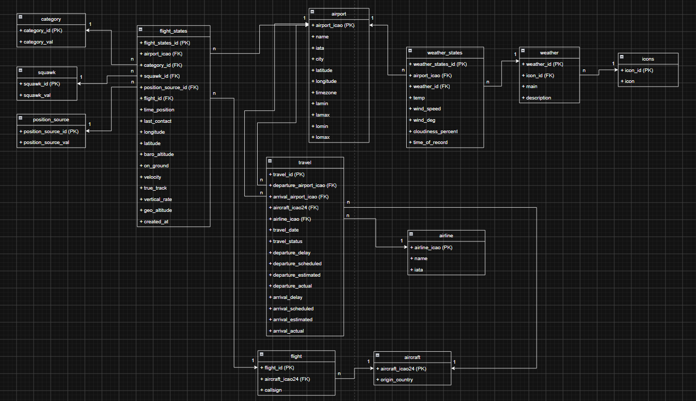

# Database Documentation

Store flight data from OpenSkyAPI and weather data from OpenWeatherAPI
- DBMS: PostgreSQL

## Overview

The project uses PostgreSQL (hosted on Supabase). The schema separates raw
source lineage from dashboard-ready relational data:

- 'ingestion' records every collected JSON snapshot and its processing status;
- 'public' contains reference data and normalised OpenSky and OpenWeather
  observations.

Raw files remain on disk under 'data/raw'; their relative path and complete JSON
payload are also registered in the database. This provides traceability from a
dashboard observation back to its source response.

## Schema Documentation

### Raw ingestion and lineage

**Schema** 'ingestion'; **table** 'raw_snapshot':

- 'snapshot_id' **(PK) bigint identity**
  Unique identifier for a collected response.
- 'provider', 'resource', 'airport_icao', 'collected_at'
  Identify the source, resource, airport, and UTC collection time.
- 'source_observed_at' **timestamptz NULL**
  Timestamp reported by the source, populated during normalisation when
  available.
- 'raw_file_path' **TEXT UNIQUE NOT NULL**
  Relative path of the immutable raw JSON file. The unique constraint makes
  registration idempotent.
- 'payload' **JSONB NOT NULL**
  Complete source response retained for replay and audit.
- 'ingested_at', 'normalised_at', 'normalisation_error'
  Track registration, successful normalisation, and the latest processing
  failure respectively.

### OpenSky data model
**Table** timezone:
- timezone_id **(PK) autoincrement NOT NULL**
    Description: Unique identifier for a timezone

- name **TEXT UNIQUE NOT NULL**
    Description: Timezone name

**Table** aircraft:
- aircraft_icao24 **(PK) CHAR(6) NOT NULL**
    Column in OpenSkyAPI: ICAO24 -> string
    Description: Unique ICAO 24-bit address of the aircraft in hex string representation.
- origin_country **TEXT NULL**
    Column in OpenSkyAPI: origin_country -> string
    Description: Country name inferred from the ICAO 24-bit address

**Table** flight_state:
- flight_state_id **(PK) autoincrement NOT NULL**
    Description: Unique identifier for an observation of a flight

- airport_icao **(FK -> airport.airport_icao) NOT NULL**
    Description: Airport bounding box for which the aircraft state was collected

- category_id **(FK -> category.category_id) NULL**
    Description: Foreign key referencing the category

- squawk_id **(FK -> squawk.squawk_id) NULL**
    Description: Foreign key referencing the squawk

- position_source_id **(FK -> position_source.position_source_id) NULL**
    Description: Foreign key referencing the position source

- aircraft_icao24 **(FK -> aircraft.aircraft_icao24)**
    Description: icao24 of the observable aircraft

- callsign **VARCHAR(8) NULL**
    Description: callsign of the observable aircraft

- time_position **timestamptz NULL**
    Column in OpenSkyAPI: time_position -> int
    Description: Unix timestamp (seconds) for the last position update. Can be null if no position report was received by OpenSky within the past 15s

- last_contact **timestamptz NULL**
    Column in OpenSkyAPI: last_contact -> int
    Description: Unix timestamp (seconds) for the last update in general. This field is updated for any new, valid message received from the transponder

- latitude **DECIMAL(9, 6) NULL**
    Column in OpenSkyAPI: latitude -> float 
    Description: WGS-84 latitude in degrees.

- longitude **DECIMAL(9, 6) NULL**
    Column in OpenSkyAPI: longitude -> float
    Description: WGS-84 longitude in decimal degrees

- baro_altitude **DECIMAL(7, 2) NULL**
    Column in OpenSkyAPI: baro_altitude -> float
    Description: The aircraft’s pressure-derived altitude in meters

- geo_altitude **DECIMAL(7, 2) NULL**
    Column in OpenSkyAPI: geo_altitude -> float
    Description: Geometric altitude in meters

- on_ground **boolean NOT NULL**
    Column in OpenSkyAPI: on_ground -> boolean
    Description: true -> position is on the ground, false -> position is in the air

- velocity **DECIMAL(6, 2) NULL**
    Column in OpenSkyAPI: velocity -> float
    Description: Velocity over ground in m/s

- true_track **DECIMAL(5, 2) NULL**
    Column in OpenSkyAPI: true_track -> float
    Description: True track in decimal degrees clockwise from north (north=0°)

- vertical_rate **DECIMAL(6,2) NULL**
    Column in OpenSkyAPI: vertical_rate -> float
    Description: Vertical speed in metres per second. The widened precision
    accommodates typical climb and descent rates.

- created_at **timestamptz NOT NULL** 
    Description: Time of api-call that collected the state

- snapshot_id **(FK -> ingestion.raw_snapshot.snapshot_id)**
    Description: tracking of the ingested jsonb object

**Table** airport: maintained from 'data/reference_data/airports.json'
- airport_icao **(PK) char(4) NOT NULL**
    Description: ICAO of the airport

- name **TEXT NOT NULL**
    Description: name of the airport

- iata **char(3) NULL**
    Description: IATA code of the airport, supplied by the manually maintained
    airport reference file.

- city **TEXT NOT NULL**
    Description: city of the airport

- latitude **DECIMAL(9, 6) NULL**
    Description: latitude of the airport

- longitude **DECIMAL(9, 6) NULL**
    Description: longitude of the airport

- timezone **(FK -> timezone.timezone_id) NULL**
    Description: Official IANA timezone identifier of the airport

- lamin **DECIMAL(9, 6) NULL**
    Description: lower bound for the latitude in decimal degrees

- lamax **DECIMAL(9, 6) NULL**
    Description: upper bound for the latitude in decimal degrees

- lomin **DECIMAL(9, 6) NULL**
    Description: lower bound for the longitude in decimal degrees

- lomax **DECIMAL(9, 6) NULL**
    Description: upper bound for the longitude in decimal degrees

**Table** category:
- category_id **(PK) integer NOT NULL**
    Column in OpenSkyAPI: category -> int
    Description: Key/PK of the category

- category_val **TEXT NULL**
    Description: Readable label of category. Category data are not present in
    the current non-extended OpenSky state payload and are therefore NULL in the
    implemented normalisation flow.

**Table** position_source:
- position_source_id **(PK) smallint identity NOT NULL**
    Description: Internal key of the position-source lookup.

- opensky_code **smallint UNIQUE NULL**
    Column in OpenSkyAPI: position_source -> int
    Description: OpenSky source code used to map a state vector to the lookup.

- position_source_val **TEXT NULL**
    Description: Readable label of the source, for example 'ADS_B', 'ASTERIX',
    'MLAT', or 'FLARM'.

**Table** squawk:
- squawk_id **(PK) CHAR(4) NOT NULL**
    Column in OpenSkyAPI: squawk -> string
    Description: Four-character transponder code when supplied by OpenSky.

- squawk_val **TEXT NULL**
    Description: Optional readable description; it is not populated
    automatically by the current pipeline.

### OpenWeatherAPI
**Table** weather:
- weather_id **(PK) SERIAL NOT NULL**
    Description: Internal identifier of a distinct weather condition. It is not
    the OpenWeather 'weather.id'; the condition is uniquely identified by its
    icon, main label, and description.

- icon_id **(FK -> icon.icon_id) NULL**
    Column in OpenWeatherAPI: weather.icon -> string
    Description: Foreign Key to table icons.icon_id

- main **TEXT NULL**
    Column in OpenWeatherAPI:  weather.main -> string
    Description: Group of weather parameters

- description **TEXT NULL**
    Column in OpenWeatherAPI: weather.description -> string
    Description: Weather description

**Table** icon:
- icon_id **(PK) char(3) NOT NULL**
    Column in OpenWeatherAPI: weather.icon -> string
    Description:  Unique identifier of the weather icon

- icon **TEXT NULL**
    Column in OpenWeatherAPI: N/A (Generated URL or local file path)
    Description: Full URL to OpenWeather icon asset (e.g. "https://openweathermap.org/img/wn/01d@2x.png")

**Table** weather_state:
- weather_state_id **(PK) autoincrement NOT NULL**
    Description: Unique identifier of the weather states

- airport_icao **(FK -> airport.airport_icao) CHAR(4) NOT NULL**
    Description: Foreign key referencing the airport where the weather was fetched

- weather_id **(FK -> weather.weather_id) integer NOT NULL**
    Description: Foreign key referencing the weather condition type

- temperature_c **DECIMAL(5, 2) NULL**
    Column in OpenWeatherAPI: main.temp -> float
    Description: Temperature in degrees Celsius

- wind_speed_mps **DECIMAL(5, 2) NULL**
    Column in OpenWeatherAPI: wind.speed -> float
    Description: Wind speed in m/s

- wind_direction_deg **INTEGER NULL**
    Column in OpenWeatherAPI: wind.deg -> float
    Description: Wind direction in degrees

- wind_gust_mps **DECIMAL(5,2) NULL**
    Column in OpenWeatherAPI: wind.gust -> float
    Description: Wind gusts speed

- cloudiness_percent **INTEGER NULL**
    Column in OpenWeatherAPI: clouds.all
    Description: Cloudiness percentage

- visibility_m **INTEGER NULL**
    Column in OpenWeatherAPI: visibility
    Description: visibility in meters

- time_of_record **timestamptz NOT NULL**
    Column in OpenWeatherAPI: dt -> int
    Description: Time of data calculation, converted from UTC Unix timestamp

- snapshot_id **(FK -> ingestion.raw_snapshot(snapshot_id))**
    Description: ingestion tracking of raw jsonb object

### Future schedule model (not implemented)

The following entities were prepared for a possible schedule-data provider.
They are not populated by the current collectors or normalisation pipeline.

**TABLE** travel:
- travel_id **(PK) autoincrement NOT NULL**
    Description: Unique identifier for a flight
    
- departure_airport_icao **(FK-> airport.airport_icao) CHAR(4) NULL**
    Description: Foreign key referencing the departure airport
    
- arrival_airport_icao **(FK-> airport.airport_icao) CHAR(4) NULL**
    Description: Foreign key referencing the arrival airport
    
- aircraft_icao24 **(FK-> aircraft.aircraft_icao24) CHAR(6) NULL**
    Description: Foreign key referencing the aircraft
    
- airline_icao **(FK-> airline.airline_icao) CHAR(3) NULL**
    Description: Foreign key referencing the airline 
    
- travel_date **date NULL**
    Column in AviationStackAPI: data.flight_date
    Description: Scheduled date of the flight
    
- travel_status **(FK -> status.status_id) NULL**
    Column in AviationStackAPI: data.flight_status
    Description: Current operational status of the flight
    
- departure_delay **integer NULL**
    Column in AviationStackAPI: data.departure.delay
    Description: Departure delay measured in minutes
    
- departure_scheduled **timestamptz NULL**
    Column in AviationStackAPI: data.departure.scheduled
    Description: Originally published time of departure
    
- departure_estimated **timestamptz NULL**
    Column in AviationStackAPI: data.departure.estimate
    Description: Estimated time of departure updated dynamically based on real-time flight changes
    
- departure_actual **timestamptz NULL**
    Column in AviationStackAPI: data.departure.actual
    Description: Exact actual time the aircraft took off or left the gate
    
- arrival_delay **integer NULL**
    Column in AviationStackAPI: data.arrival.delay
    Description: Arrival delay measured in minutes compared to the scheduled time
    
- arrival_scheduled **timestamptz NULL**
    Column in AviationStackAPI: data.arrival.scheduled
    Description: Originally published time of arrival
    
- arrival_estimate **timestamptz NULL**
    Column in AviationStackAPI: data.arrival.estimate
    Description: Estimated time of arrival dynamically calculated during flight execution
    
- arrival_actual **timestamptz NULL**
    Column in AviationStackAPI: data.arrival.actual
    Description: Exact actual time the aircraft touched down or arrived at the gate

**TABLE** airline:
- airline_icao **(PK) CHAR(3) NOT NULL**
    Column in AviationStackAPI: data.airline.icao
    Description: ICAO designator code assigned to the airline
    
- name **TEXT NULL**
    Column in AviationStackAPI: data.airline.name
    Description: name of the airline company
    
- iata **CHAR(2) NULL**
    Column in AviationStackAPI: data.airline.iata 
    Description: iata commercial airline designation code

## Constraints, indexes, and idempotency

The schema validates airport coordinates and bounding-box ordering, weather
cloudiness (0--100), and wind direction (0--360). Foreign keys preserve the
relationship between observations, their lookup values, airports, and raw
snapshots.

The following constraints make normalisation repeatable:

- 'raw_snapshot.raw_file_path' is unique;
- 'weather(icon_id, main, description)' is unique;
- 'weather_state.snapshot_id' is unique;
- 'flight_state(snapshot_id, aircraft_icao24)' is unique.

Indexes support the main dashboard and operational queries: aircraft states by
airport/time and aircraft/time, weather states by airport/time, and raw
snapshots by provider/airport/collection time.

## Database creation and migrations

Run the SQL files in numerical order. Files '1'--'3' create the foundational,
ingestion, and observation tables; files '4' and '5' add normalisation
constraints; file '6' contains the subsequent schema repair that widens
'flight_state.vertical_rate' and seeds the OpenSky position-source lookup.

## Entity-Relationship Diagram
