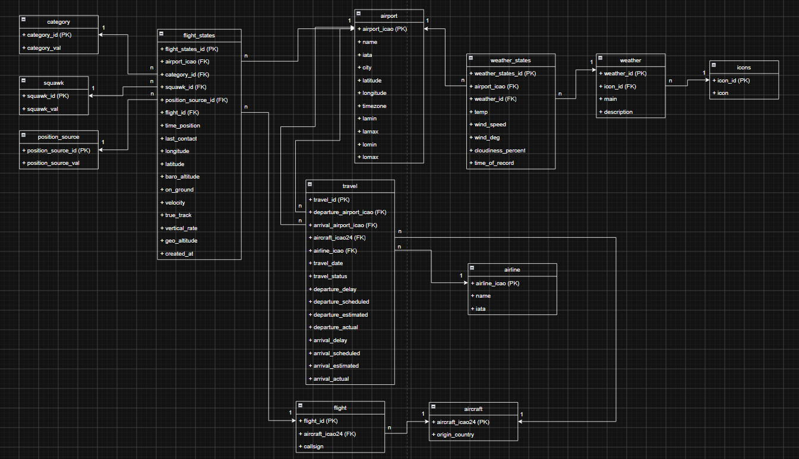

# Database Documentation

Store flight data from OpenSkyAPI and weather data from OpenWeatherAPI
- DBMS: PostgreSQL

## Schema Documentation:
### OpenSkyAPI
**Table** aircraft:
- aircraft_icao24 **(PK) CHAR(6) NOT NULL**
    Column in OpenSkyAPI: ICAO24 -> string
    Description: Unique ICAO 24-bit address of the aircraft in hex string representation.
- origin_country **VARCHAR(36) NULL**
    Column in OpenSkyAPI: origin_country -> string
    Description: Country name inferred from the ICAO 24-bit address

**Table** flight_states:
- flight_states_id **(PK) autoincrement NOT NULL**
    Description: Unique identifier for a continuous flight session

- airport_icao **(FK -> airport.airport_icao) NOT NULL**
    Description: Foreign key referencing the aircraft

- category_id **(FK -> category.category_id) NULL**
    Description: Foreign key referencing the category

- flight_id **(FK -> flight.flight_id) NULL**
    Description: Foreign key referencing the flight

- time_position **timestamp NULL**
    Column in OpenSkyAPI: time_position -> int
    Description: Unix timestamp (seconds) for the last position update. Can be null if no position report was received by OpenSky within the past 15s

- last_contact **timestamp NULL**
    Column in OpenSkyAPI: last_contact -> int
    Description: Unix timestamp (seconds) for the last update in general. This field is updated for any new, valid message received from the transponder

- longitude **DECIMAL(9, 6) NULL**
    Column in OpenSkyAPI: longitude -> float
    Description: WGS-84 longitude in decimal degrees

- latitude **DECIMAL(9, 6) NULL**
    Column in OpenSkyAPI: latitude -> float 
    Description: WGS-84 latitude in degrees.

- baro_altitude **DECIMAL(10, 2) NULL**
    Column in OpenSkyAPI: baro_altitude -> float
    Description: The aircraft’s pressure-derived altitude in meters

- on_ground **boolean NOT NULL**
    Column in OpenSkyAPI: on_ground -> boolean
    Description: true -> position is on the ground, false -> position is in the air

- velocity **DECIMAL(6, 2) NULL**
    Column in OpenSkyAPI: velocity -> float
    Description: Velocity over ground in m/s

- true_track **DECIMAL(5, 2) NULL**
    Column in OpenSkyAPI: true_track -> float
    Description: True track in decimal degrees clockwise from north (north=0°)

- geo_altitude **DECIMAL(10, 2) NULL**
    Column in OpenSkyAPI: geo_altitude -> float
    Description: Geometric altitude in meters

- squawk_id **(FK -> squawk.squawk_id) NULL**
    Description: Foreign key referencing the squawk

- position_source_id **(FK -> position_source.position_source_id)**
    Description: Foreign key referencing the position source

- created_at **timestamp NOT NULL** 
    Description: Time of api-call that collected the state

**Table** flight:
- flight_id **(PK) autoincrement NOT NULL**
    Description: Unique identifier for a continuous flight session

- aircraft_icao24 **(FK -> aircraft.aircraft_icao24) NOT NULL**
    Description: Foreign key referencing the aircraft

- callsign **VARCHAR(8) NULL**
    Column in OpenSkyAPI: callsign -> string
    Description: 8-character callsign of the vehicle (e.g. flight number)

**Table** airport: is manual, but we can get these data from the OpenWeatherAPI 
- airport_icao **(PK) char(4) NOT NULL**
    Description: ICAO of the airport

- iata **char(4) NULL** (NYI)
    Column in AviationStackAPI: data.airport.iata
    Description: IATA code of the airport used for commercial flight routing
    Comes from AviationStackAPI

- name **VARCHAR(150) NOT NULL**
    Description: name of the airport

- city **VARCHAR(100) NOT NULL**
    Description: city of the airport

- latitude **DECIMAL(9, 6) NULL**
    Description: latitude of the airport

- longitude **DECIMAL(9, 6) NULL**
    Description: longitude of the airport

- timezone **VARCHAR(50) NULL**
    Description: Official IANA timezone identifier of the airport

- lamin **DECIMAL(9, 6) NULL**
    Description: lower bound for the latitude in decimal degrees

- lamax **DECIMAL(9, 6) NULL**
    Description: upper bound for the latitude in decimal degrees

- lomin **DECIMAL(9, 6) NULL**
    Description: lower bound for the longitude in decimal degrees

- lomax **DECIMAL(9, 6) NULL**
    Description: upper bound for the longitude in decimal degrees

**Table** category:
- category_id **(PK) integer NOT NULL**
    Column in OpenSkyAPI: category -> int
    Description: Key/PK of the category

- category_val **VARCHAR(255) NOT NULL**
    Column in OpenSkyAPI: category -> int
    Description: Readable label of category

**Table** position_source: 
- position_source_id **(PK) integer NOT NULL**
    Column in OpenSkyAPI: position_source -> int
    Description: Key/PK of the position_source

- position_source_val **VARCHAR(255) NOT NULL**
    Column in OpenSkyAPI: position_source -> int
    Description: Readable label of position_source

**Table** squawk:
- squawk_id **(PK) CHAR(4) NOT NULL**
    Column in OpenSkyAPI: squawk -> string
    Description: Key/PK of the squawk (transponder code) only from ICAO, Germany and Europe

- squawk_val **VARCHAR(255) NOT NULL**
    Column in OpenSkyAPI:  squawk -> string
    Description: Readable label of squawk (transponder code) only from ICAO, Germany and Europe

### OpenWeatherAPI
**Table** weather:
- weather_id **(PK) INTEGER NOT NULL**
    Column in OpenWeatherAPI: weather.id -> int
    Description: Unique identifier of the weather

- main **VARCHAR(50) NOT NULL**
    Column in OpenWeatherAPI:  weather.main -> string
    Description: Group of weather parameters

- description **VARCHAR(255) NULL**
    Column in OpenWeatherAPI: weather.description -> string
    Description: Weather description

- icon_id **(FK) VARCHAR(10) NULL**
    Column in OpenWeatherAPI: weather.icon -> string
    Description: Foreign Key to table icons.icon_id

**Table** icons:
- icon_id **(PK) VARCHAR(10) NOT NULL**
    Column in OpenWeatherAPI: weather.icon -> string
    Description:  Unique identifier of the weather icon

- icon **VARCHAR(255) NOT NULL**
    Column in OpenWeatherAPI: N/A (Generated URL or local file path)
    Description: Full URL to OpenWeather icon asset (e.g. "https://openweathermap.org/img/wn/01d@2x.png")

**Table** weather_states:
- weather_states_id **(PK) autoincrement NOT NULL**
    Description: Unique identifier of the weather states

- airport_icao **(FK -> airport.airport_icao) CHAR(4) NOT NULL**
    Description: Foreign key referencing the airport where the weather was fetched

- weather_id **(FK -> weather.weather_id) integer NOT NULL**
    Description: Foreign key referencing the weather condition type

- temp **DECIMAL(5, 2) NULL**
    Column in OpenWeatherAPI: data.temp -> float
    Description: Temperature in degrees Celsius

- wind_speed **DECIMAL(5, 2) NULL**
    Column in OpenWeatherAPI: data.wind_speed -> float
    Description: Wind speed in m/s

- wind_deg **DECIMAL(5, 2) NULL**
    Column in OpenWeatherAPI: data.wind_deg -> float
    Description: Wind direction in degrees

- cloudiness_percent **DECIMAL(5, 2) NULL**
    Column in OpenWeatherAPI: data.cloudiness_percent
    Description: Cloudiness percentage

- time_of_record **timestamp NOT NULL**
    Column in OpenWeatherAPI: data.dt -> int
    Description: Time of data calculation, converted from UTC Unix timestamp

### AviationStackAPI (NYI)
**TABLE** travel:
- travel_id **(PK) autoincrement NOT NULL**
    Description: Unique identifier for a flight
    
- departure_airport_icao **(FK-> airport.airport_icao) CHAR(4) NOT NULL**
    Description: Foreign key referencing the departure airport
    
- arrival_airport_icao **(FK-> airport.airport_icao) CHAR(4) NOT NULL**
    Description: Foreign key referencing the arrival airport
    
- aircraft_icao24 **(FK-> aircraft.aircraft_icao24) CHAR(6) NOT NULL**
    Description: Foreign key referencing the aircraft
    
- airline_icao **(FK-> airline.airline_icao) VARCHAR(6) NOT NULL**
    Description: Foreign key referencing the airline 
    
- travel_date **timestamp NULL**
    Column in AviationStackAPI: data.flight_date
    Description: Scheduled date of the flight
    
- travel_status **VARCHAR(20) NULL**
    Column in AviationStackAPI: data.flight_status
    Description: Current operational status of the flight
    
- departure_delay **integer NULL**
    Column in AviationStackAPI: data.departure.delay
    Description: Departure delay measured in minutes
    
- departure_scheduled **timestamp NULL**
    Column in AviationStackAPI: data.departure.scheduled
    Description: Originally published time of departure
    
- departure_estimate **timestamp NULL**
    Column in AviationStackAPI: data.departure.estimate
    Description: Estimated time of departure updated dynamically based on real-time flight changes
    
- departure_actual **timestamp NULL**
    Column in AviationStackAPI: data.departure.actual
    Description: Exact actual time the aircraft took off or left the gate
    
- arrival_delay **integer NULL**
    Column in AviationStackAPI: data.arrival.delay
    Description: Arrival delay measured in minutes compared to the scheduled time
    
- arrival_scheduled **timestamp NULL**
    Column in AviationStackAPI: data.arrival.scheduled
    Description: Originally published time of arrival
    
- arrival_estimate **timestamp NULL**
    Column in AviationStackAPI: data.arrival.estimate
    Description: Estimated time of arrival dynamically calculated during flight execution
    
- arrival_actual **timestamp NULL**
    Column in AviationStackAPI: data.arrival.actual
    Description: Exact actual time the aircraft touched down or arrived at the gate

**TABLE** airline:
- airline_icao **(PK) VARCHAR(6) NOT NULL**
    Column in AviationStackAPI: data.airline.icao
    Description: ICAO designator code assigned to the airline
    
- name **VARCHAR(255) NOT NULL**
    Column in AviationStackAPI: data.airline.name
    Description: name of the airline company
    
- iata **CHAR(4) NULL**
    Column in AviationStackAPI: data.airline.iata 
    Description: iata commercial airline designation code

# Entity-Relationship-Diagram
